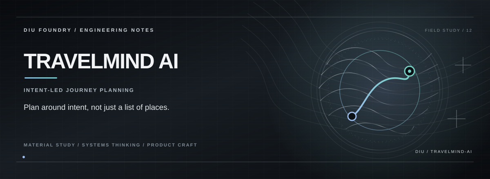

# TRAVELMIND AI

**A travel-planning interface that organises destination discovery around a traveller's mood, constraints, and itinerary.**

TravelMind AI includes a destination catalogue, discovery sections, sign-in and dashboard routes, and an AI-assistant interface. The current destination records are defined in `src/lib/mock-data.ts`, including demonstration values for cost, crowding, safety, matching, and booking probability. These values are sample content, not live travel intelligence or verified safety ratings.

## Planning flow

```text
Choose a travel mood / constraint
             │
             ▼
Explore the destination catalogue
             │
             ▼
Compare the displayed attributes
             │
             ▼
Shape a trip plan
             │
             ▼
Review and refine the itinerary
```

## Product surfaces

- **Destination discovery:** Browse a curated sample catalogue with imagery and tags.
- **Preference-oriented recommendations:** Explore how different trip attributes might be compared.
- **Insights and assistant UI:** A place for future conversational or data-backed planning.
- **Account and dashboard routes:** An application foundation for a more personalised planning flow.

## Stack

React · TypeScript · Vite · TanStack Router / Start · Framer Motion · Tailwind CSS

## Run locally

**Requirements:** Node.js and Bun (recommended).

```bash
git clone https://github.com/Kishordiu/travelmind-ai.git
cd travelmind-ai
bun install
bun run dev
```

Use the local URL printed by Vite.

## Data and booking boundary

The visible sample data does not establish that AI recommendations, crowd levels, safety scores, costs, booking probabilities, weather, transport, or accommodation availability are live or independently verified. The repository should not be treated as a booking engine. Check real prices, entry rules, local guidance, and bookings with authoritative providers before travelling.

---

<p align="center"><sub>DIU FOUNDRY · TRAVEL / PERSONALISATION / PRODUCT SYSTEMS</sub></p>
